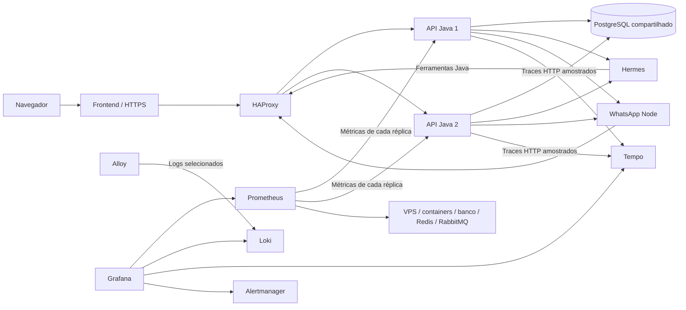

# VPS, concorrência e observabilidade

## Grafana no ambiente local atual

Para manter Java no host e monitorar os serviços existentes, use `compose.observability.local.yaml` (sem o overlay VPS). Prepare as credenciais uma única vez:

```powershell
.\scripts\Initialize-Observability.ps1
docker compose -f compose.yaml -f compose.observability.yaml -f compose.observability.local.yaml up -d grafana prometheus loki tempo alloy docker-metrics-proxy postgres-exporter redis-exporter node-exporter blackbox alertmanager
```

Inicie a API com `.\mvnw.cmd spring-boot:run "-Dspring-boot.run.profiles=observability-local"` (sem iniciar uma segunda API se já houver uma na porta 8080). Esse perfil abre a porta 9091 para o coletor, exigindo uma chave própria em `AYLA_METRICS_SCRAPE_KEY`, preparada pelo script. A chave fica somente nos servidores e não dá acesso às rotas de dados pessoais. Métricas sem chave ou com chave incorreta são bloqueadas. O perfil VPS continua usando a porta interna não publicada da rede Docker.

O lançamento **Ayla (Java 25)** em `.vscode/launch.json` já ativa `observability-local` para manter a coleta ao iniciar pelo VS Code. Pelo Maven, continue usando o argumento de perfil acima. No dashboard, **Uso de recursos da API Java** mostra CPU por réplica, memória JVM em bytes (heap + não heap) e ocupação do heap em percentual. A memória da JVM não é o RSS total do processo nem o consumo total do container; pilhas e algumas alocações nativas ficam fora desse contador. O percentual de CPU segue a normalização da JVM/sistema operacional. Os indicadores consultam o valor atual e mostram **Sem coleta** se a instância não estiver sendo coletada, sem substituir ausência de dados por zero. Os gráficos históricos existentes continuam disponíveis abaixo.

Abra http://localhost:3300/d/ayla-vps. O usuário está em `GRAFANA_ADMIN_USER`, e a senha gerada/preservada está em `GRAFANA_ADMIN_PASSWORD`, no `.env`. O script nunca imprime credenciais e não troca uma senha já configurada. O arquivo de coleta em `docker/observability/secrets` é ignorado pelo Git e pelo build Docker. Preserve o volume Grafana para manter usuários e preferências.

No ambiente local há uma API, sem balanceador: os gráficos de HAProxy e cAdvisor ficam vazios. A regra de duas réplicas é aplicada apenas ao deployment VPS. O Node Exporter local mostra CPU e memória da VM Linux do Docker Desktop, não do Windows inteiro. Disco e rede do host ficam desabilitados no overlay local para evitar dados enganosos e montagens incompatíveis; na VPS Linux a configuração completa mede o próprio host. O cAdvisor fica opcional no perfil Compose `linux-host`. RabbitMQ precisa do plugin `rabbitmq_prometheus`; o Compose prepara sua configuração para novas inicializações, e uma instância já existente pode habilitá-lo com `docker exec ayla-rabbitmq rabbitmq-plugins enable rabbitmq_prometheus`, sem reiniciar o broker.

O perfil local também grava logs JSON com rotação em `target/observability/logs/ayla.log`; Alloy os coleta para Loki com os mesmos filtros de segurança dos logs Docker. Traces são enviados à porta OTLP 4318, publicada somente em loopback. Métricas, logs e traces Java começam quando a API estiver executando com o perfil local.

O frontend inclui o botão do Grafana somente para o superadministrador após reconstruí-lo com o overlay local. Não é necessário enviar o token da Ayla ao Grafana: ele usa seu próprio login administrativo, com a porta restrita ao computador local.

Ativação local verificada: dashboard com 44 painéis, login obrigatório, coleta de PostgreSQL/Redis/RabbitMQ e CPU/memória da VM Docker, API com métricas autenticadas e bloqueio sem chave. A API foi iniciada em segundo plano com o perfil local; saída do inicializador em `target/ayla-observability-stdout.log` e `target/ayla-observability-stderr.log`. Ao iniciar a API manualmente no futuro, mantenha o argumento de perfil indicado acima. Os testes dos perfis local e VPS foram executados com PostgreSQL temporário e compilação isolada (`-Pisolated-checks`), sem recarregar a API durante os testes.

Implantação inicial para Oracle Ampere A1 Flex, ARM64, 2 OCPUs e 12 GB de RAM. O Compose local permanece separado da implantação na VPS. As imagens Java, Hermes e serviços de observabilidade são multi-arquitetura; não force `platform: linux/amd64` na Ampere.

## Arquitetura



O HAProxy usa `leastconn`, descobre as réplicas pelo DNS Docker e verifica `/readyz`. Uma réplica sem banco ou ainda iniciando sai da rotação. O DNS tem até oito slots; não aumente réplicas sem recalcular RAM e conexões. Há até duas tentativas de conexão, com redistribuição, exclusivamente quando a requisição não pôde ser enviada (`conn-failure`). Não há repetição automática de requisições já enviadas, respostas 5xx, respostas vazias ou timeout de resposta: repetir um POST após uma resposta perdida pode duplicar uma ação. Os aliases públicos `/actuator/health` e `/actuator/health/readiness` são encaminhados pelo balanceador para `/readyz`.

Autenticação, sessões, memória e dados pessoais ficam no PostgreSQL. A migração V29 também persiste a autorização OAuth do Hermes: começar o login em uma réplica e consultar em outra funciona, sem sessão fixa no balanceador. Locks consultivos PostgreSQL impedem duas réplicas de executar simultaneamente o mesmo turno de conversa, provisionamento de perfil ou aplicação/síntese de voz do mesmo perfil. Conversas diferentes continuam em paralelo. O conflito retorna 409; capacidade local esgotada retorna 429, sem reenviar automaticamente para a IA. Cada lock usa uma conexão do pool durante a operação; não exige uma transação aberta durante toda a inferência. Não use PgBouncer em modo transaction para essas conexões.

O overlay genérico usa duas réplicas de até 1 GiB, três chats ativos e pool de doze conexões por réplica. Para a **Oracle A1 de 2 OCPUs e 12 GB**, use [ORACLE_FREE.md](ORACLE_FREE.md): o overlay adicional reduz cada API para 768 MiB, dois chats e oito conexões, e impõe um teto compartilhado de 1,8 CPU e 10 GiB para toda a stack. Consultas CRUD continuam concorrentes; o Hermes e o provedor podem limitar o processamento de chats. WhatsApp e Hermes permanecem únicos; subir vários clientes para o mesmo WhatsApp pode duplicar respostas. PostgreSQL, balanceador e a própria VPS também continuam pontos únicos de falha. Duas réplicas melhoram disponibilidade de processos, não tolerância à perda da VPS nem a capacidade de CPU física.

## Subir na VPS

Na Oracle de 2 OCPUs / 12 GB, siga primeiro [ORACLE_FREE.md](ORACLE_FREE.md) para instalar o limite conjunto. Acrescente `-f compose.oracle-free.yaml` **depois** de `compose.observability.yaml` em todos os comandos desta seção. Use as imagens publicadas e `up -d --no-build` para evitar builds na VPS.

1. Instale Docker Engine e Compose v2 no Linux ARM64. Copie o projeto e crie `.env` a partir de `.env.example`, usando senhas e chaves próprias. Preserve as chaves e volumes se já houver dados.
2. Configure `GRAFANA_ADMIN_PASSWORD` com senha exclusiva, `COMPOSE_PROJECT_NAME=ayla`, o IP público em `AYLA_PUBLIC_IP` e sua origem HTTPS em `AYLA_FRONTEND_ORIGINS`. `GRAFANA_BROWSER_URL` controla o link exibido ao superadministrador (padrão: acesso local por túnel SSH).
3. Valide e suba a stack:

```sh
docker compose -f compose.yaml -f compose.vps.yaml -f compose.observability.yaml config --quiet
docker compose -f compose.yaml -f compose.vps.yaml -f compose.observability.yaml up -d --build
docker compose -f compose.yaml -f compose.vps.yaml -f compose.observability.yaml ps
```

Não execute esse comando sobre o ambiente local esperando preservar o Java iniciado no host: o overlay muda o roteamento para as APIs em container. Na VPS, os serviços internos apontam para `api-gateway:8080`, e ambas as APIs usam o mesmo banco e Hermes. O Flyway coordena as migrações pelo banco. Em atualização, faça backup consistente do PostgreSQL e do volume Hermes antes de aplicar migrações. Não use `down -v` no ambiente real.

Somente o frontend expõe portas públicas 80/443. A API Java e a porta de gerenciamento 9091 não são publicadas. As portas já existentes de PostgreSQL, Redis, RabbitMQ, WhatsApp e Hermes continuam restritas ao loopback do host. Não abra essas portas nas regras da Oracle. O certificado gerado automaticamente é local/autossinado; para acesso público definitivo configure certificado confiável e domínio. O frontend atual não provisiona certificado público automaticamente.

## Abrir o Grafana

No seu computador:

```sh
ssh -L 3300:127.0.0.1:3300 usuario@IP_DA_VPS
```

Abra http://localhost:3300/d/ayla-vps e entre com `GRAFANA_ADMIN_USER` (padrão `superadmin`) e a senha configurada. Esse é o login administrativo do Grafana, separado do login da Ayla. Não há cadastro público nem acesso anônimo. Não compartilhe essa conta com usuários comuns. O link aparece somente no monitoramento do superadministrador; a porta segue privada. Se alterar a senha no `.env` depois que o volume Grafana já existir, isso não muda automaticamente a senha armazenada pelo Grafana: use sua administração de usuários.

O dashboard **Ayla — aplicação e VPS** é provisionado com as fontes de dados. Mostra estado dos serviços, réplicas, tráfego por instância, erros 5xx, latência p95 separando chat das demais rotas, JVM, GC, Hikari, PostgreSQL, CPU, memória, disco, rede, containers, Redis, RabbitMQ e alertas ativos. Um painel vazio pode indicar ausência de tráfego ou coleta indisponível; consulte a saúde das fontes. Node Exporter mede o Linux da VPS; no Docker Desktop mede a VM Linux do Docker. cAdvisor precisa das montagens de host e privilégios definidos no Compose; use somente no host administrado por você.

Prometheus descobre cada IP de réplica diretamente na porta 9091. Coletar somente pelo balanceador perderia as diferenças entre instâncias. A porta 8080 não libera `/actuator/prometheus`, mesmo com o perfil VPS; o listener privado possui uma cadeia de segurança própria. Não publique a 9091 nem exponha a rede Docker em ambiente não confiável.

## Logs, traces e erros

### Uso da IA no painel da Ayla

O superadministrador encontra **Uso da IA** em Monitoramento, com entrada, saída, total informado, chamadas, falhas, ausências de contagem, gráfico diário e rankings por usuário/modelo. O gráfico possui seletores próprios de usuário e período, incluindo os últimos dois meses, e linhas com pontos, legenda e valores ao passar o mouse. `GET /api/v1/monitoring/ai-usage` usa `from`, `to`, `userId` e `source`. `GET /api/v1/monitoring/ai-usage/calls` aceita os mesmos filtros e `page`/`size`, exibindo tokens por chamada; o total do período inclui todas as páginas. Os filtros de resultado e busca de ações continuam exclusivos da atividade HTTP. A API verifica tanto o papel OWNER quanto a identidade real do proprietário e envia `Cache-Control: no-store`.

O histórico de IA fica retido por **dois meses de calendário**, calculados em UTC. A limpeza roda uma hora após a anterior (primeira execução um minuto após iniciar a API), usando o índice de data; somente `ai_usage_events` é afetada. Mesmo antes da próxima limpeza, as consultas não exibem registros fora dessa janela. As réplicas podem executar a limpeza concorrentemente sem duplicar dados. A retenção não afeta financeiro, conversas ou memória pessoal. Os gráficos preservam a instância existente e atualizam os dados sem animação; animação ocorre apenas na construção inicial e respeita movimento reduzido. Atualizações de 15 segundos com os mesmos dados não redesenham o gráfico; redimensionar/rolar a tela não recria a instância.

A migração V30 cria `ai_usage_events` no PostgreSQL compartilhado pelas réplicas. Cada resposta de `/api/sessions/{id}/chat` registra uma chamada, incluindo análise visual e a correção financeira adicional. O registro usa o perfil para identificar o usuário; não grava mensagens, instruções, arquivos, chaves ou credenciais. Falhas HTTP/timeout sem uso retornado são contadas com tokens não informados. Falha no armazenamento da telemetria não interrompe o chat nem causa nova inferência. A contagem começa após ativar essa versão; não há importação do histórico.

São contadores devolvidos pelo Hermes, não uma fatura: chamadas auxiliares internas (como pesquisa/memória), novas tentativas internas do Hermes e áudio podem não constar nessas respostas. Tokens desconhecidos não são estimados nem classificados como uso gratuito. O painel não calcula custo, crédito restante ou limite da conta. Os dias usam `America/Sao_Paulo`; os totais incluem todos os usuários/modelos e cada ranking exibe até 50. Para ativar, reinicie a API para aplicar a migração e recrie o frontend com o build atualizado.

Se o chat retornar 502 com `O Hermes não concluiu a resposta`, confira a causa no Hermes: uma resposta HTTP recebida pelo Java ainda pode representar um turno não concluído. O bootstrap aplica `docker/hermes/prepare_auth.py` à versão fixada do Hermes para manter o store/lock OAuth Nous em `<perfil>/.ayla-nous-auth`, resolvendo o perfil a cada chamada. Não use um caminho inexistente em `/proc` para impedir compartilhamento: isso também impede a renovação de credenciais. Não use um diretório global gravável: misturaria identidades entre usuários. A adaptação valida a implementação upstream e impede a inicialização caso ela seja incompatível. Após atualizar o arquivo montado e o Compose, recrie somente o serviço `hermes`, preservando o volume; as credenciais existentes em cada perfil continuam intactas. Mudanças na imagem Hermes exigem rever essa adaptação e executar `docker/hermes/tests/test_auth_scope.py`.

Os erros por usuário e ação continuam no menu Monitoramento da Ayla, exclusivo do superadministrador. No Grafana Explore, Loki permite filtrar logs por serviço/container e buscar `requestId`. Os logs Java JSON incluem correlação de trace quando houver amostragem. Tempo recebe os traces HTTP de entrada e das chamadas Java feitas pelos builders instrumentados para Hermes/WhatsApp. Isso não instrumenta internamente o Python, o navegador do WhatsApp ou cada chamada ao banco; não é uma visão de spans internos desses serviços. Traces são amostrados em 10%, ajustáveis em `TRACE_SAMPLING_PROBABILITY`.

Os logs HTTP do frontend e HAProxy não gravam URLs, query strings ou corpos. As métricas de saída normalizam IDs de perfil, sessão e conversa. Não são usados usuário, e-mail ou mensagem como labels. Os logs brutos de Hermes/WhatsApp/PostgreSQL não são enviados ao Loki porque podem conter mensagens, QR ou parâmetros; os erros operacionais do WhatsApp já entram pelo endpoint de monitoramento existente. Alloy filtra padrões de credenciais como defesa adicional; não habilite logging DEBUG de corpos no ambiente real. Acesso aos logs locais também deve ser administrativo. O proxy Docker usado pelo Alloy é privado e nega escrita na API Docker.

Retenção inicial: métricas sete dias/até 4 GB; logs 72 horas; traces 24 horas. Os logs dos serviços principais rodam com 10 MB × três arquivos por container. A retenção temporal do Loki/Tempo não é um limite rígido de disco; acompanhe o volume e o alerta de disco. Os limites de memória são tetos, não reservas, e não eliminam OOM sob cargas ou muitos navegadores WhatsApp. Monitore e ajuste antes de aumentar usuários.

## Alertas

Há regras para serviço/réplica indisponível, ausência total de réplicas, perda da segunda réplica, 5xx elevados, espera por conexão de banco, CPU/memória altas, disco abaixo de 15% e falha de coleta. Elas aparecem no Prometheus e no Grafana/Alertmanager. Nenhuma notificação externa está configurada: escolha um destino em `docker/observability/alertmanager.yml` antes de habilitar e-mail, webhook ou outro canal. Monitoramento na própria VPS também cai se ela cair; para detectar perda total da VPS é necessário um monitor externo independente.

## Testar carga sem chamar a IA

Para subir a concorrência gradualmente e acompanhar os resultados no Grafana, execute `.\scripts\Test-Load.ps1`. Etapas padrão: 5 → 10 → 25 → 50 usuários virtuais, somente leituras. Há também um modo de consulta financeira autenticada. Comandos, limites e interpretação: [tests/load/README.md](tests/load/README.md).

O script `tests/load/api.js` faz somente leituras. Na VPS:

```sh
docker run --rm --network ayla_default -i -e BASE_URL=http://api-gateway:8080 grafana/k6:1.4.0 run - < tests/load/api.js
```

O padrão usa dez usuários virtuais por trinta segundos, consultando readiness, com p95 abaixo de 1,5 s e menos de 1% de falhas. Isso valida HTTP/balanceamento e acesso de saúde ao banco; não mede inferência nem CRUD completo. Para testar consultas financeiras, injete um access token de teste em `ACCESS_TOKEN` sem salvá-lo em arquivos ou histórico de shell. Não faça testes destrutivos com os dados pessoais reais. Verifique no Grafana a distribuição entre réplicas e meça na ARM real antes de estabelecer limites de usuários ou latência.

## Validação realizada

Os testes com PostgreSQL temporário verificaram exclusão mútua entre duas instâncias, concorrência de conversas diferentes, liberação após falha e continuidade do OAuth em outra réplica. Um teste HTTP com portas reais verificou o bloqueio de métricas na porta pública, a coleta na porta privada e a disponibilidade do readiness. Também passaram os testes de autenticação/inativação, isolamento Hermes e API WhatsApp executados nesta alteração. O frontend passou nos sete testes unitários e no build.

Em Docker Desktop Linux/amd64, duas APIs reais, um PostgreSQL temporário e HAProxy atenderam 1.470 leituras de readiness com dez usuários virtuais por trinta segundos: nenhuma falha, aproximadamente 48,7 requisições/s e p95 de 7,3 ms. Houve tráfego nas duas réplicas. Depois de desligar uma delas, vinte leituras passaram durante a transição com reconexão `conn-failure`. Métricas das duas réplicas, logs no Loki e traces no Tempo foram conferidos; Grafana carregou o dashboard e as quatro fontes de dados. O Compose e as configurações de HAProxy/Alloy foram validados.

O build completo da imagem Docker Java também passou, e as doze regras de alertas foram verificadas com `promtool`. O dashboard inclui métricas de conversas ativas, recusas por capacidade/concorrência e disponibilidade efetiva de PostgreSQL e Redis, além da disponibilidade dos exportadores.

Essas medições são do ambiente local, com leituras de saúde e sem IA ou dados pessoais; não são um benchmark da Oracle ARM nem uma estimativa da capacidade do provedor. As imagens foram verificadas quanto à disponibilidade ARM64. A ativação e a medição na VPS continuam necessárias.

Referências: [Spring Boot Metrics](https://docs.spring.io/spring-boot/reference/actuator/metrics.html), [Spring Boot Tracing](https://docs.spring.io/spring-boot/reference/actuator/tracing.html), [HAProxy Prometheus](https://www.haproxy.com/documentation/haproxy-configuration-tutorials/alerts-and-monitoring/prometheus/), [HAProxy e reconexões](https://www.haproxy.com/documentation/haproxy-configuration-tutorials/reliability/retries/), [Grafana Alloy e Docker](https://grafana.com/docs/alloy/latest/monitor/monitor-docker-containers/), [cAdvisor](https://github.com/google/cadvisor/blob/master/docs/running.md).
